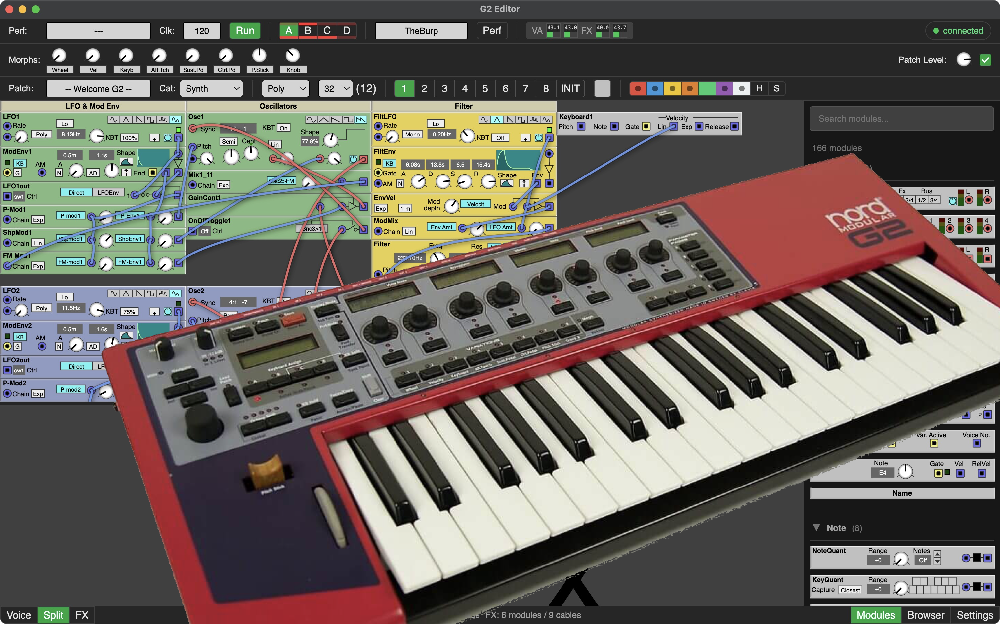

# Nord Modular G2 Editor

A cross-platform editor for the Nord Modular G2 synthesizer.

**Goal:** stay close to the original Clavia editor workflow. Key commands, menu, toolbars and module rendering are almost identical, so G2 users feel at home. Apart from that there are some improvements: fixed side panels instead of floating windows, and more ways of patching to fit different workflows and speed up patching.

[Download & Install](getting-started/){: .btn .btn-primary .mr-2 }
[♥ Donate](https://www.paypal.com/donate/?hosted_button_id=UZE943PYKY5S6){: .btn }

---

## Project Status

See the [Changelog](https://github.com/JanBurp/NordModularG2-Editor/blob/main/CHANGELOG.md) for more details

| Goal | Status |
|---|---|
| Core USB, Parsing, Basic Editing, etc. | ✅ Done |
| Undo/Redo, MIDI CC assignment, Browser, Variation copy, Led's in patch, etc. | ✅ Done |
| Morph Editing, Parameter Pages Assignment | ✅ Done |
| Patch Adjuster, Mutator, Advanced Features | 🗓 Planned |

### Video of version v0.7.0 (october 2026)

### Editor and terminal

- **Editor:** the desktop app for creating and editing patches and performances. Everything for normal use.
- **CLI / daemon (`g2-cli`):** the same USB layer that the editor uses, without a GUI. Use it for scripting and automation (bank backup/restore, batch uploads, getting and setting patches), for headless control, and for protocol research and debugging. The editor itself talks to the G2 through this daemon. See [CLI Commands](technical/cli-commands).

## Acknowledgements

Protocol knowledge from the Nord G2 community at [electro-music.com](https://electro-music.com): the [Delphi Editor by bverhue](https://www.bverhue.nl/g2dev/), [patchviewer by ian-s](https://electro-music.com/patchviewer/), and [g2ools by qfingers](https://electro-music.com/forum/viewtopic.php?t=15405). Also thanks to Chris Purusha for technical discussions and a copy of the reverse enigineered editor. Åke Danielson for graphics of the mini modules, BlueHell for lending an Engine and all who tested and or donated to this project.

## Donate

This editor is free and built in spare time. Donations help cover coding-agent subscriptions and test hardware (spare G2).

